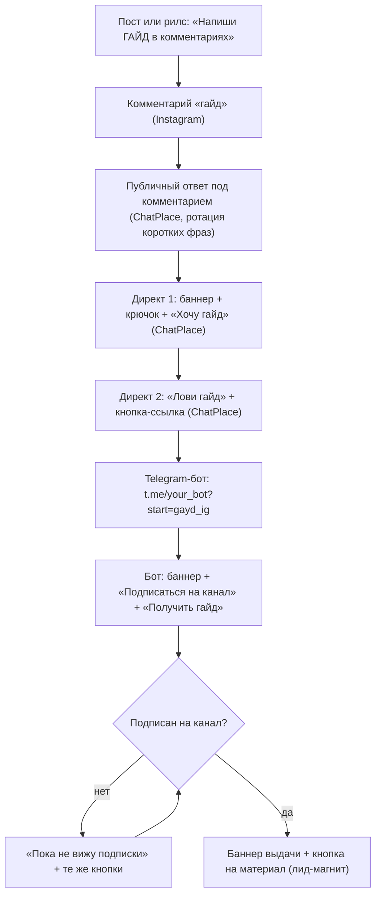

<p align="center">
  
</p>

[](LICENSE)
[](#установка-в-claude-code-и-codex)

# instagram-telegram-chatplace-funnel

Набор скиллов для Claude Code и Codex: воронка «кодовое слово в Instagram → автоответ и директ через ChatPlace →
Telegram-бот → подписка на канал → лид-магнит». Для студентов курса по AI-агентам: поставили, вызвали агента,
собрали свою воронку и проверили её до публикации поста.

ChatPlace здесь эталонная реализация. Если вы работаете с другим сервисом (ManyChat, SaleBot, SendPulse, Puzzlebot,
Leadteh, BotHelp, чистый Telegram Bot API), набор можно адаптировать: см. [«Адаптация под другие сервисы»](#адаптация-под-другие-сервисы).

## Схема воронки



Одно кодовое слово = одна воронка, у каждой своя реф-ссылка бота и своя пригласительная ссылка канала: так видно,
сколько людей пришло и подписалось по каждому слову.

## Что внутри

| Папка | Что делает |
|---|---|
| `skills/instagram-codewords` | слово под постом: правила, написания, тексты директа, публичные ответы, проверка слова до публикации |
| `skills/chatplace-funnels` | API ChatPlace: воронки, шаги, кнопки, метки, реф-ссылки; воронка в боте с проверкой подписки; аналитика |
| `skills/telegram-bot-setup` | бот в @BotFather, подключение к ChatPlace, админ канала, проверка подписки, инвайты с именем и лимитом 99999 |
| `skills/funnel-banners` | баннеры: бриф, публичный скилл баннеров, `codex-image`, правила текста, размеры, загрузка в ChatPlace |
| `skills/funnel-links` | реф-ссылки, UTM, инвайты, необязательные короткие ссылки |
| `skills/codex-image` | картинки через подписку Codex, без платного API |

Остальное: `docs/ADAPTING.md` – адаптация под другие сервисы, `scripts/` – установка и локальные проверки, `tests/` – офлайн-тесты.

## Быстрый старт

1. Клонируйте репозиторий и создайте `.env` из шаблона: `cp .env.example .env` (файл в `.gitignore`).
2. Установите скиллы: `scripts/install.sh` (подробнее – [ниже](#установка-в-claude-code-и-codex)) и перезапустите сессию агента.
3. Создайте бота в @BotFather, сделайте его администратором канала и впишите токен и id канала в `.env`.
4. Попросите агента: «Собери воронку с кодовым словом ГАЙД по скиллам instagram-codewords и chatplace-funnels».
5. Проверьте воронку со второго аккаунта до публикации поста и только потом включайте её.

Что делает каждый шаг по порядку и какие команды запускать – в [пошаговом примере](#пошаговый-пример-воронка-со-словом-гайд).

## Что понадобится

| Что | Зачем |
|---|---|
| Instagram-аккаунт (бизнес или автор) | на нём работают комментарии и директ |
| Аккаунт ChatPlace с подключённым Instagram и API-ключ | автоответы и воронки; тариф для API и место выдачи ключа – проверьте в документации ChatPlace |
| Telegram-бот от @BotFather | вторая половина воронки |
| Telegram-канал, где бот администратор | подписка на канал перед выдачей |
| Python 3.10+ и `curl` | все скрипты на стандартной библиотеке; `curl` – запасной путь, если Cloudflare режет `urllib` |
| Подписка ChatGPT/Codex (по желанию) | генерация баннеров в скилле `codex-image` без платного API |
| Второй Instagram-аккаунт для тестов | аккаунт не отвечает сам себе, слово проверяют с другого |

Сторонние пакеты не нужны. Единственное исключение: скилл `codex-image` при первом запуске `run.sh` ставит пакет `openai`
в собственное окружение `.venv` (нужен, чтобы читать поток ответа Codex-бэкенда).

## Установка в Claude Code и Codex

```bash
git clone https://github.com/<ваш-аккаунт>/instagram-telegram-chatplace-funnel.git
cd instagram-telegram-chatplace-funnel
cp .env.example .env            # впишите свои значения, файл в .gitignore
```

**Claude Code** (скиллы доступны во всех проектах):

```bash
scripts/install.sh                     # копирует skills/* в ~/.claude/skills
scripts/install.sh --link              # или симлинки, чтобы обновляться через git pull
scripts/install.sh --target ./.claude/skills   # только для текущего проекта
```

**Codex:** `scripts/install.sh --target <папка со скиллами Codex>`. Какую папку читает ваша версия Codex –
проверьте в документации Codex. Скрипты внутри скиллов обычные Python-файлы, их можно запускать и вручную.

После установки перезапустите сессию агента и попросите, например: «Собери воронку с кодовым словом ГАЙД по скиллам
instagram-codewords и chatplace-funnels». Агент сам откроет нужный SKILL.md.

Переменные окружения загружаются так: `set -a; . ./.env; set +a`.

## Пошаговый пример: воронка со словом ГАЙД

Порядок важен: сначала Telegram-часть (чтобы существовала реф-ссылка бота), потом Instagram-часть.

### Шаг 1. Бот

1. @BotFather → `/newbot` → имя и username (например `your_bot`) → токен в `.env` как `TELEGRAM_BOT_TOKEN`.
2. `python3 skills/telegram-bot-setup/scripts/tg_api.py me` – должен вывести `@your_bot id=…`.
3. Подключите бота к ChatPlace в кабинете (место в интерфейсе – по документации ChatPlace) и узнайте его id:
   `python3 skills/chatplace-funnels/scripts/chatplace.py bots` → `CHATPLACE_TG_BOT_ID` в `.env`.

### Шаг 2. Канал и права

1. Сделайте бота администратором канала с правом «Добавление подписчиков».
2. Id канала (`-100XXXXXXXXXX`) – в `.env` как `TELEGRAM_CHANNEL_ID` (подсказка, где его взять, – в `telegram-bot-setup`).
3. `python3 skills/telegram-bot-setup/scripts/tg_api.py check-admin` – должно быть `OK`.

### Шаг 3. Пригласительная ссылка слова

```bash
python3 skills/telegram-bot-setup/scripts/tg_api.py invite --name gayd-ig --registry invites.json
```

Имя ссылки = источник, `member_limit` = 99999 (ссылки без лимита иногда ломаются). Ссылка вида `https://t.me/+…` пойдёт в кнопку «Подписаться на канал».

### Шаг 4. Баннеры

Опишите баннер брифом (`skills/funnel-banners`), сделайте баннер 1 (приветствие) и баннер 2 (выдача) – они должны заметно
отличаться. Выложите готовые jpg на публичный URL и получите id медиа:

```bash
python3 skills/chatplace-funnels/scripts/chatplace.py media-upload https://example.com/banner1.jpg --platform telegram
```

Id запишите в `welcome_media` и `after_media` конфига бота, а id картинки для директа Instagram (`--platform instagram`) – в `photo_id`.

### Шаг 5. Воронка в боте

```bash
cp skills/chatplace-funnels/examples/gate.example.json gate.json     # отредактируйте тексты, ссылку на материал, invite, channel_id
python3 skills/chatplace-funnels/scripts/gate.py check gate.json
python3 skills/chatplace-funnels/scripts/gate.py build gate.json
```

`build` создаёт воронку, переписывает тексты, пересобирает кнопки без обёртки ChatPlace, прикрепляет баннеры и создаёт
реф-ссылку `gayd_ig` → `https://t.me/your_bot?start=gayd_ig`. Шаблон проверки подписки сразу включает воронку, поэтому
гоняйте его на тестовом слове до публикации.

Проверка с чистого Telegram-аккаунта: откройте реф-ссылку → Start → «Получить гайд» без подписки (ожидаем «Пока не вижу
подписки») → подпишитесь по кнопке → «Получить гайд» (ожидаем выдачу).

### Шаг 6. Воронка в Instagram

```bash
cp skills/chatplace-funnels/examples/codeword.example.json funnel.json   # слово, тексты, ссылка на бота, 15 публичных ответов
python3 skills/chatplace-funnels/scripts/codeword.py check funnel.json
python3 skills/chatplace-funnels/scripts/codeword.py create funnel.json --bot-id <ID Instagram-бота> --dry-run
python3 skills/chatplace-funnels/scripts/codeword.py create funnel.json --bot-id <ID Instagram-бота>
```

Воронка создаётся **на паузе**. В `button_link` стоит реф-ссылка бота из шага 5.

### Шаг 7. Тест слова до публикации

Подробная процедура – в `skills/instagram-codewords/SKILL.md`. Коротко: включить воронку, написать слово со второго аккаунта
комментарием и сообщением, проверить публичный ответ, оба директа и кнопку, пройти бота до выдачи, проверить все написания.
Перед правкой живой воронки делайте бэкап: `chatplace.py backup <id> backups/gayd.json`.

### Шаг 8. Публикация и аналитика

1. Поставьте слово в подпись поста или рилса текстом: «Напиши ГАЙД в комментариях».
2. Включите воронку: `chatplace.py status <id> active` (если не включали при тесте).
3. Смотрите `chatplace.py health --bot-id <ID>` и `chatplace.py analytics <id> --from … --to …`; число вступивших по имени
   ссылки видно в Telegram (Управление каналом → Пригласительные ссылки).

## Адаптация под другие сервисы

Набор не привязан к ChatPlace. ChatPlace – эталонная реализация, а схема воронки (слово в комментарии → директ → бот →
проверка подписки → выдача) одинакова у любого сервиса автоворонок. Если вы используете не ChatPlace, а ManyChat, SaleBot,
SendPulse, Puzzlebot, Leadteh, BotHelp или чистый Telegram Bot API, адаптируйте набор, а не отказывайтесь от него.

Что делать:

1. Откройте [`docs/ADAPTING.md`](docs/ADAPTING.md): там таблица сервисов со ссылками на официальную документацию и
   соответствие шагов воронки понятиям другого сервиса.
2. Прочитайте официальную документацию вашего сервиса (ссылки в таблице) и сопоставьте каждый шаг воронки.
3. Перепишите клиент ChatPlace (`skills/chatplace-funnels/scripts/`) под API вашего сервиса. Настройку бота, пригласительные
   ссылки, баннеры и правила кодового слова менять не нужно.
4. Сохраните правила: ключи только в окружении, слово проверяется до публикации, инвайты с `member_limit` 99999.

Агентам в репозитории это же описано в `AGENTS.md` и `CLAUDE.md`: любой агент, открывший репозиторий, должен
понимать, что набор адаптируется под любой сервис.

## Безопасность

- Секреты только в переменных окружения и `.env` (он в `.gitignore`). Скрипты не печатают ключ и токен и маскируют их в ошибках.
- `invites.json` и папка `backups/` в `.gitignore`: в них реальные ссылки и содержимое воронок.
- Скрипты, которые меняют ChatPlace, создают воронки на паузе и не включают их без вашей команды. Вызовов в Instagram и
  рассылок скрипты не делают.
- Идентификаторы в примерах – заглушки (`your_bot`, `-100XXXXXXXXXX`, `cp_FAKE…`).

### Проверки

```bash
python3 -m unittest discover -s tests     # офлайн, сеть не нужна (HTTP подменён)
scripts/check.sh                          # синтаксис, тесты, поиск секретов и личных путей
```

### Что не подтверждено

Описание API ChatPlace собрано из рабочих заметок авторов, а не из официальной документации. Не проверено: тариф и место
выдачи API-ключа, точный ответ `automations_quick_setup` (id воронки, имя в списке), регистр у `commentContains`,
подключение Telegram-бота в кабинете, задержка напоминания, лимит кнопки в Instagram, работа `urllib` без запасного `curl`
в вашей сети, папка скиллов Codex, условия использования входа по подписке Codex. Такие места помечены в SKILL.md фразой
«проверьте в документации ChatPlace» (или Codex).

## Лицензия

MIT, см. [`LICENSE`](LICENSE).
